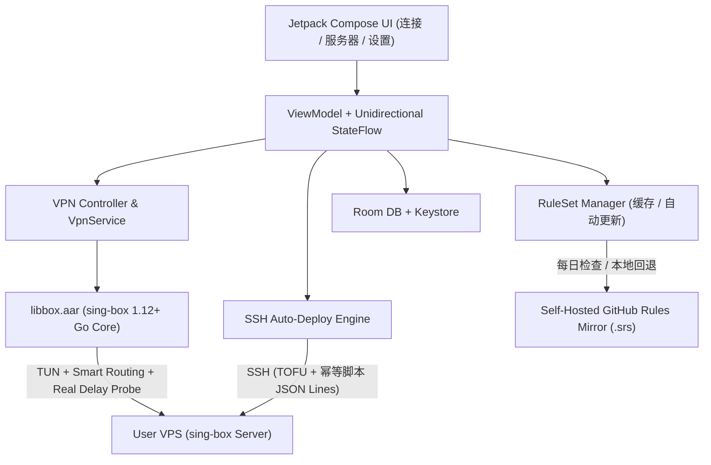
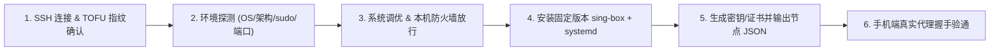

# Build MyVpn — 完整产品与技术开发方案 V1.1

> **平台**：Android（Kotlin + Jetpack Compose） · **协议**：免费开源（GPLv3+） · **定位**：用户自备 VPS 一键部署与连接 · **变现**：纯净无内置广告（官网 + VPS 返佣 + 自愿捐赠）

---

## 一、V1.0 → V1.1 核心拍板与变更摘要

在 V1.0 极简产品形态基础上，V1.1 重点解决了**开源许可证合规、客户端长期可维护性、目标地区变现现实以及 VPS 部署安全性**四个核心工程问题：

| 维度 | V1.0 原方案 | V1.1 定稿方案 | 变更原因 |
| :--- | :--- | :--- | :--- |
| **客户端底座** | Fork `SFA`（sing-box for Android）并删减 UI | **全新 Jetpack Compose 项目 + 官方 `libbox.aar`** | 界面仅 2 个主 Tab + 1 个设置页，新写壳代码极轻、1:1 还原极简交互、无 `SFA` 历史包袱，升级 `sing-box` 内核零合并冲突 |
| **变现与合规** | App 底部接 Google AdMob Banner | **V1.0 移除 App 内 AdMob**；改为官网广告 + VPS 选购 Affiliate 返佣 + 设置页自愿捐赠 | 彻底规避 `GPLv3 + 闭源 AdMob SDK` 许可证冲突；中/伊/俄地区 AdMob 填充与变现差且伤隐私口碑；VPS 返佣与目标用户刚需高度重合 |
| **SSH 凭据安全** | `Android Keystore` 持久化保存 | **SSH 密码默认“用后即焚”不落盘**（仅内存使用，重装时临时输入或用户手动开启保存） | 大幅降低用户对“把服务器密码交给第三方 App”的信任阻力 |
| **Hysteria2 策略与证书** | 笼统支持 IP / 域名、无封锁风险提示 | **默认仅部署纯 `VLESS + REALITY`（TCP 443）**；Hysteria2 仅在用户主动启用时以 **UDP 443 同端口共存**，强制展示**高封锁风险警告**；域名走 ACME、纯 IPv4 走自签 + `certificate_sha256` 固定 | 实测 Hysteria2（极速模式）更容易触发限速或封锁，绝不默认暴露 UDP 监听；同时保留 TCP 443 REALITY 一键秒切兜底并杜绝 `insecure: true` |
| **分流规则运维** | 直连多个第三方 GitHub 仓库 | **自建 GitHub Actions 规则镜像仓库**（每日拉取、格式/体积校验、统一发布 `.srs`） | 防止上游变更、断更或被墙导致客户端分流大面积失效 |
| **首发语言** | V1.0 同步上 16 国语言 | **架构全支持 i18n + RTL，V1.0 首发精做 4 门核心语言**（英/简中/俄/波斯语） | 减少首期文案与 RTL 回归成本，稳定后再扩至 16 语 |

---

## 二、产品定位与极简交互规范

### 2.1 产品原则（硬约束）
- **核心闭环**：`自备 VPS` → `填入地址与 SSH 凭据` → `App 自动部署` → `生成节点` → `一键连接`。
- **绝对不做**：不设账号体系、不卖订阅套餐、不运营公共节点、不建中心化管控后台。
- **主界面去噪**：不显示实时流量图表、复杂协议参数、节点测速排行榜及多余的解释性小字。

### 2.2 信息架构（2 主 Tab + 1 设置页）

#### 1. 「连接」页（首页）
严格保持从上到下的极简视觉层级，无底部 Banner 广告后视觉更干净：
1. **顶部栏**：左侧 `Build MyVpn`，右侧 `☰ 设置` 入口。
2. **核心连接区**：
   - 大号圆形一键连接/断开按钮；
   - 连接状态文案（`未连接` / `连接中…` / `已连接`）；
   - **紧凑单行真实代理延迟**：位于连接状态正下方，仅展示 `-- ms`（或 `128 ms` / `超时`）+ 右侧小刷新图标 `↻`，**不加卡片边框，不加说明提示语**。
3. **当前服务器卡片**：单行展示 `昵称 · IP/域名`（如 `我的 VPS · 203.0.113.10`），点击快速切换服务器；无服务器时引导跳转到添加 VPS。
4. **代理模式切换**：Segmented 控件切换 `智能代理`（默认）与 `全局代理`。
   - 选中 `智能代理` 时，下方单行展示当前规则（如 `🌍 通用规则 · 自动识别`），点击弹出 4 选 1 底部弹窗（`通用规则` / `中国规则` / `伊朗规则` / `俄罗斯规则`）。
5. **底部导航栏**：`连接` | `服务器`。

#### 2. 「服务器」页
- **列表项**：展示服务器昵称、IP/域名、协议徽标（`VLESS + REALITY` 或 `Hysteria2`）、当前选中状态。
- **添加 VPS 表单**：
  - 必填：服务器昵称（默认自动填充）、服务器地址（**严格校验 IPv4 或合法域名格式**，非法直接阻断并提示）、登录方式（密码 / 私钥）、SSH 密码或私钥。
  - 协议选择：
    - **`VLESS + REALITY`（默认推荐 · 稳定抗封）**：仅开启 TCP 443，不暴露多余 UDP 端口，适合绝大多数用户长期使用。
    - **`Hysteria2`（可选 · 极速模式，高封锁风险）**：勾选时展示醒目警告提示——*“实测极速模式（Hysteria2 / UDP）在受限网络中更容易被限速、阻断，甚至增加服务器端口或 IP 被封风险；日常使用强烈建议保持默认 VLESS + REALITY。”* 启用时默认采用 **TCP 443（REALITY）+ UDP 443（Hysteria2）同端口共存**，确保 UDP 失效时可一键秒切回稳定协议。
  - 折叠「高级选项」：SSH 用户名（默认 `root`）、SSH 端口（默认 `22`）。
  - 表单下方提供轻量文字链接：`还没有 VPS？查看选购指南`（跳转官网文档/返佣页）。
- **服务器编辑 / 详情页**（点击服务器卡片的更多入口进入）：
  - 修改昵称、删除服务器；
  - **协议切换 / 重新部署**（双协议共存节点支持在稳定/极速间免重装一键切换，并支持一键彻底关闭/卸载 Hysteria2 UDP 监听）；
  - **复制节点链接**（隐藏实用功能：导出标准 `vless://` 或 `hysteria2://` URI，方便用户在电脑或 iOS 复用自建节点）。

#### 3. 「设置」页
- **常规**：
  - `应用语言`（跟随系统或手动切换，兼容 Android 13+ Per-App Language）；
  - `分流规则更新`（展示本地缓存版本与更新时间、手动立即检查更新）；
  - `隐私与安全`（说明“无遥测、SSH 密码默认用后即焚”）。
- **支持与法律**：
  - `VPS 选购指南`（打开官网教程）；
  - `支持开发者`（PayPal.Me / Ko-fi 自愿捐赠入口，明确标注“不解锁额外功能”）；
  - `隐私政策`、`服务条款`、`开源许可（GPLv3+）`、`关于项目（GitHub 仓库与版本号）`。

#### 4. Android 系统级体验补齐
- **Quick Settings Tile**：系统下拉快捷开关，无需打开 App 即可一键启停 VPN。
- **网络切换自愈**：监听 `ConnectivityManager.NetworkCallback`，Wi-Fi ↔ 蜂窝切网时平滑重建底层连接（重点保障 Hysteria2 QUIC 不断死）。
- **前台服务通知**：极简展示当前节点名与“断开”快捷按钮。

---

## 三、系统架构与技术栈

### 3.1 总体分层架构



### 3.2 技术栈选型

| 层级 | 选型 | 说明 |
| :--- | :--- | :--- |
| **语言与 UI** | Kotlin + Jetpack Compose + Material 3 | 原生支持 RTL 自动镜像（波斯语/阿拉伯语）、代码量极小 |
| **VPN 内核** | **`libbox.aar`**（基于 `sing-box 1.12+` 编译） | 官方 Go Mobile Android 绑定库，直接对接 Android `VpnService` |
| **SSH 客户端** | **`com.github.mwiede:jsch`**（现代活跃维护版 JSch） | 完整支持 Ed25519 / RSA / ECDSA 私钥、密码认证、自定义 `HostKeyRepository`（TOFU 指纹校验），比 SSHJ 在 Android 上更无 BouncyCastle 冲突 |
| **异步与状态** | Kotlin Coroutines + StateFlow + Hilt（或手动轻量 DI） | 单向数据流，状态可测 |
| **本地存储** | `Room` + `Android Keystore` | Room 存服务器元数据与非敏感配置；敏感代理密码/密钥经 Keystore 加密存储；SSH 密码默认仅内存留存 |
| **网络与规则下载** | `OkHttp` + `kotlinx.serialization` | 下载 `.srs` 规则集、解析部署脚本 JSON 输出与序列化 `sing-box` 配置 |
| **服务端** | 官方固定版本 `sing-box` 二进制 + `systemd` | 与客户端内核版本对齐，免维护多套协议服务端 |

### 3.3 Android 项目模块与目录结构

```text
build-myvpn/
├── android/                          # Android 客户端（Gradle Kotlin DSL）
│   ├── app/
│   │   ├── libs/libbox.aar           # CI 自动编译并固定版本的 libbox
│   │   └── src/main/java/com/buildmyvpn/
│   │       ├── ui/
│   │       │   ├── connect/          # 连接页（状态、单行延迟、模式与规则弹窗）
│   │       │   ├── servers/          # 服务器列表、添加/校验、部署进度、编辑/导出
│   │       │   ├── settings/         # 设置、语言、规则更新、捐赠、关于
│   │       │   └── theme/            # 极简主题 + RTL 适配
│   │       ├── vpn/
│   │       │   ├── BuildMyVpnService.kt      # Android VpnService + PlatformInterface
│   │       │   ├── SingBoxConfigBuilder.kt  # 动态生成 sing-box 1.12+ JSON
│   │       │   ├── DelayTester.kt           # 经代理出口的真实 HTTPS 延迟测速
│   │       │   └── QuickTileService.kt      # 下拉快捷磁贴
│   │       ├── deploy/
│   │       │   ├── SshClientWrapper.kt      # 连接、TOFU 指纹校验、SFTP/Exec
│   │       │   ├── DeployOrchestrator.kt    # 6 步部署状态机与 JSON Lines 解析
│   │       │   └── DeployErrorMapper.kt     # 底层错误码 → 新手友好提示
│   │       ├── rules/
│   │       │   ├── RuleSetManager.kt        # 规则下载、SHA256 校验、缓存兜底
│   │       │   └── RegionDetector.kt        # 通用规则地区识别（优先本地 MCC）
│   │       └── data/
│   │           ├── db/                      # Room Database / DAO / ServerProfileEntity
│   │           └── crypto/                  # Android Keystore 加密封装
├── deploy-scripts/                   # 独立可测试的 VPS 幂等部署脚本
│   ├── install_singbox.sh            # 核心幂等部署/重装/卸载脚本（输出 JSON Lines）
│   └── tests/                        # Docker (Ubuntu 22/24, Debian 12) 集成测试
└── rules-mirror/                     # GitHub Actions 规则集镜像与校验流水线
    └── .github/workflows/build-rules.yml
```

---

## 四、核心协议设计与 `sing-box 1.12+` 配置规范

### 4.1 协议定位与默认策略

| 协议 | 定位标签 | 适用场景 | 传输层 | 部署与风控策略 |
| :--- | :--- | :--- | :--- | :--- |
| **`VLESS + REALITY`**（默认） | 稳定抗封（强烈推荐） | 绝大多数网络环境、长期稳定使用 | TCP + TLS 1.3 (REALITY) | **默认唯一开启**（TCP 443），免域名免证书，不额外暴露 UDP 端口 |
| **`Hysteria2`**（按需可选） | 极速模式（高封锁风险） | 跨洲高丢包线路临时提速（需用户确认风险） | UDP / QUIC | **默认不开启**；仅在用户确认风险提醒后以 **UDP 443 与 TCP 443 REALITY 同端口共存**部署，支持一键秒切回 REALITY 或彻底关闭 UDP 监听 |

> [!WARNING]
> **Hysteria2（极速模式）封锁风险提醒（产品必做项）**：实测表明，Hysteria2 基于 UDP + 激进拥塞控制，在严格审查或强 QoS 环境下**明显比 `VLESS + REALITY` 更容易被限速、阻断，甚至增加 VPS 端口/IP 被封的风险**。因此 UI 严禁将“极速模式”包装成无副作用的默认推荐项，必须在选择或开启前通过显著风险提示告知用户，并优先引导日常使用 `VLESS + REALITY`。

**后续协议演进预留（V1.1+）**：`sing-box 1.12+` 原生支持的 **`AnyTLS`**（缓解 TLS-in-TLS 特征、内置动态填充与连接池复用）列为 V1.1 进阶候选，尤其适合未来扩展“用户自带域名”场景；`TUIC`、`XHTTP/CDN`、`AmneziaWG` 在 V1.0 均不引入以防新手复杂度膨胀。

### 4.2 `VLESS + REALITY` 关键实现细节
1. **自动优选伪装目标（SNI）**：部署脚本内置高质量候选池（如 `www.microsoft.com`、`www.apple.com`、`aws.amazon.com`、`www.cloudflare.com`、`addons.mozilla.org` 等支持 TLS 1.3 + H2 + X25519 且无强跳转的站点），在 VPS 本机并行探测，选取**握手正常且 RTT 最低**的站点作为 `server_name` / `handshake.server`。
2. **端口策略**：默认首选 `443` 端口以最大化伪装度；若检测到 443 已被 Nginx/Apache/Caddy 占用，脚本自动报告冲突并给出高位随机端口回退选项，不粗暴杀掉用户已有 Web 服务。
3. **传输特征强化**：服务端与客户端统一启用 `flow: "xtls-rprx-vision"`，客户端开启 `utls`（默认 `chrome` 指纹），随机生成 8 字节 `short_id` 与 X25519 密钥对。
4. **系统调优**：部署脚本根据 VPS 发行版、虚拟化类型与内核版本自动启用 TCP BBR 加速（详见第 5.3 节）。

### 4.3 `Hysteria2` 双证书路径（彻底解决 IP vs 域名安全隐患）
- **路径 A：用户输入的是域名**
  1. 部署脚本先做 DNS 解析检查，确认域名的 A/AAAA 记录已指向当前 VPS 公网 IP；
  2. 通过 `sing-box` 内置 ACME（或轻量 ACME 流程）自动申请并续签 Let's Encrypt 证书；
  3. 客户端使用标准 TLS 校验（`server_name` 为该域名）。
- **路径 B：用户输入的是纯 IPv4 地址**
  1. 部署脚本使用 `openssl` 在 VPS 本地生成有效期 10 年的 **ECDSA P-256 自签证书**（SAN 包含该 IPv4）；
  2. 脚本计算证书 DER 格式的 **SHA-256 Base64 摘要**（`openssl x509 -in cert.pem -outform DER | openssl dgst -sha256 -binary | base64`），随部署结果 JSON 返回给 App；
  3. 客户端 `sing-box` 出站配置写入 `tls.certificate_sha256` 进行**证书固定（Certificate Pinning）**，**严禁使用 `insecure: true`**。
- **UDP 调优与后续预留**：脚本自动调大 `net.core.rmem_max` / `net.core.wmem_max` 至 8MB 以上；V1.1+ 预留 `iptables` DNAT 端口跳跃（Port Hopping）扩展位。

### 4.4 `sing-box 1.12+` 客户端配置模板（参考标准）

> [!IMPORTANT]
> `sing-box 1.12+` 废弃了旧版字符串式 DNS `address` 及 inbound `sniff` 布尔开关，统一改用**强类型 DNS server**、**路由 `action: "sniff"` / `"hijack-dns"`** 与 `route.default_domain_resolver`。以下模板严格对齐 1.12+ 规范：

```json
{
  "log": { "level": "warn", "timestamp": true },
  "dns": {
    "servers": [
      { "tag": "dns-local", "type": "local" },
      { "tag": "dns-remote", "type": "https", "server": "1.1.1.1", "server_port": 443, "detour": "proxy" }
    ],
    "rules": [
      { "rule_set": ["geosite-direct"], "server": "dns-local" }
    ],
    "final": "dns-remote",
    "strategy": "prefer_ipv4",
    "independent_cache": true
  },
  "inbounds": [
    {
      "type": "tun",
      "tag": "tun-in",
      "address": ["172.19.0.1/30", "fdfe:dcba:9876::1/126"],
      "auto_route": true,
      "strict_route": true
    }
  ],
  "outbounds": [
    {
      "type": "vless",
      "tag": "proxy",
      "server": "203.0.113.10",
      "server_port": 443,
      "uuid": "<GENERATED_UUID>",
      "flow": "xtls-rprx-vision",
      "tls": {
        "enabled": true,
        "server_name": "<SELECTED_SNI>",
        "utls": { "enabled": true, "fingerprint": "chrome" },
        "reality": {
          "enabled": true,
          "public_key": "<GENERATED_PUBLIC_KEY>",
          "short_id": "<GENERATED_SHORT_ID>"
        }
      }
    },
    { "type": "direct", "tag": "direct" }
  ],
  "route": {
    "default_domain_resolver": "dns-local",
    "auto_detect_interface": true,
    "rule_set": [
      { "tag": "geosite-direct", "type": "local", "format": "binary", "path": "<LOCAL_CACHED_GEOSITE_SRS>" },
      { "tag": "geoip-direct", "type": "local", "format": "binary", "path": "<LOCAL_CACHED_GEOIP_SRS>" }
    ],
    "rules": [
      { "action": "sniff" },
      { "protocol": "dns", "action": "hijack-dns" },
      { "ip_is_private": true, "outbound": "direct" },
      { "rule_set": ["geosite-direct", "geoip-direct"], "outbound": "direct" }
    ],
    "final": "proxy"
  }
}
```

**Hysteria2（纯 IPv4 证书固定）出站片段替换示例**：

```json
{
  "type": "hysteria2",
  "tag": "proxy",
  "server": "203.0.113.10",
  "server_port": 443,
  "password": "<GENERATED_HY2_PASSWORD>",
  "tls": {
    "enabled": true,
    "server_name": "203.0.113.10",
    "alpn": ["h3"],
    "certificate_sha256": ["<BASE64_DER_SHA256_FROM_DEPLOY>"]
  }
}
```

> [!NOTE]
> 客户端 `rule_set` 采用 **`type: "local"` 指向 App 私有缓存目录中的 `.srs` 文件**，由 `RuleSetManager` 独立负责后台静默下载、SHA-256 校验和原子替换。这样即使启动 VPN 时 GitHub 不可达，内核也能 **0 阻塞瞬间启动**，且彻底避免远程规则下载失败导致内核起不来或回落直连。

---

## 五、VPS SSH 幂等自动部署引擎

### 5.1 核心设计原则
- **禁止碎片化拼命令**：所有远端安装逻辑封装在一份带版本与 SHA-256 校验的幂等脚本 `install_singbox.sh` 中（内置在 App assets 里），App 通过 SSH 传输并执行。
- **结构化进度协议（JSON Lines）**：脚本向 `stdout` 输出单行 JSON 事件（例如 `{"step":"env_check","status":"ok","os":"ubuntu-24.04","arch":"amd64"}`），App 精准渲染进度与错误码，无需脆弱的正则解析终端文本。
- **幂等与可重装**：重复执行同一脚本不会产生残留垃圾或端口冲突；支持参数化切换协议（`--protocol reality|hy2`）和完整卸载（`--uninstall`）。

### 5.2 六步部署状态机



1. **Step 1 — SSH 连接与主机指纹校验（TOFU）**：首次连接弹窗展示服务器 SSH 公钥 SHA-256 指纹供确认并记录；若后续重连指纹发生突变，高危警告并阻断，防中间人攻击。
2. **Step 2 — 环境探测**：校验系统为受支持发行版（首期覆盖 Ubuntu 20.04/22.04/24.04、Debian 11/12/13、CentOS Stream/Rocky/Alma 9）、CPU 架构（`amd64` / `arm64`）、可用内存与磁盘、`root` 或无密码/密码 `sudo` 权限，以及目标端口占用情况。
3. **Step 3 — 网络调优与防火墙**：按系统自适应开启 TCP BBR 加速（见第 5.3 节）、按需调大 UDP buffer；自动探测并配置 `ufw` / `firewalld` / `iptables` 放行目标 TCP 或 UDP 端口。
4. **Step 4 — 安装与托管**：从官方固定版本下载对应架构的 `sing-box` 并校验 SHA-256，安装至 `/usr/local/bin/sing-box`，配置独立的 `build-myvpn-singbox.service`（开启开机自启与异常重启）。
5. **Step 5 — 配置生成与回传**：生成服务端 `/etc/build-myvpn/config.json`，启动并验证 `systemctl is-active` 及端口监听状态，最后输出标准 JSON 节点凭据供 App 入库。
6. **Step 6 — 手机端真实连通验证**：App 拿到配置后，由手机端发起一次真实代理握手测试。若服务已启动但手机连不上，**明确提示检查云厂商控制台安全组（TCP/UDP 端口放行）**。

### 5.3 按系统自适应自动开启 BBR 加速规范

为确保小白 VPS 在不同发行版与虚拟化环境下都能安全获得加速收益且**绝不把机器搞失联**，部署脚本按以下矩阵自适应处理 BBR：

| 系统 / 环境类型 | 探测方式 | 自动执行策略 | 结果状态码 (`bbr_status`) |
| :--- | :--- | :--- | :--- |
| **已开启 BBR 的任意系统** | 读取 `/proc/sys/net/ipv4/tcp_congestion_control` 已为 `bbr` | 幂等跳过，不改动原有系统配置 | `already_enabled` |
| **KVM / 物理机 — Ubuntu 20.04/22.04/24.04、Debian 11/12/13、Rocky/Alma/CentOS Stream 9**（内核 ≥ 4.9） | `systemd-detect-virt` 非容器 + 检查 `tcp_available_congestion_control` 或 `modprobe tcp_bbr` | 写入独立配置文件 `/etc/sysctl.d/99-build-myvpn-bbr.conf`（`net.core.default_qdisc = fq` + `net.ipv4.tcp_congestion_control = bbr`；若 `fq` 不可用自动降级为 `fq_codel`），执行 `sysctl --system` 并复检生效 | `enabled` |
| **OpenVZ / LXC 共享内核容器** | `systemd-detect-virt` 返回 `openvz` / `lxc` 或 `/proc/sys/...` 只读 | 无法在容器内改宿主机内核参数，静默跳过，不阻断主流程 | `skipped_container` |
| **极旧内核（< 4.9）或精简无 `tcp_bbr` 模块内核** | `uname -r` < 4.9 或 `modprobe tcp_bbr` 失败 | **严禁擅自更换内核并重启 VPS**（防 GRUB 故障与 SSH 断连失联）；安全降级跳过并记录日志，照常完成 VPN 部署 | `unsupported_kernel` |

- **不污染宿主机原配置**：统一写入 `/etc/sysctl.d/99-build-myvpn-bbr.conf`（兼容 Debian 13 等已移除默认 `/etc/sysctl.conf` 的新系统），不往 `/etc/sysctl.conf` 盲目追加重复行；执行 `--uninstall` 时同步删除该文件并重载 `sysctl`。
- **结果透明但不打扰主界面**：`bbr_status` 随 Step 3 的 JSON Lines 事件回传给 App，仅记入部署日志/服务器详情，不在连接主页增加技术噪音。

### 5.4 高频错误码映射（面向小白的可恢复体验）

| 错误码 | 触发场景 | 用户侧清晰引导 |
| :--- | :--- | :--- |
| `ERR_AUTH_FAILED` | SSH 密码或私钥错误 | 用户名或密码不正确，请核对 VPS 控制台信息（部分云厂商默认用户名是 `ubuntu` 或 `debian` 而非 `root`） |
| `ERR_PORT_IN_USE` | 443 端口被已有 Web 服务占用 | 443 端口已被占用，点击「改用其他端口」自动继续部署 |
| `ERR_CLOUD_FIREWALL` | VPS 服务端已运行，但手机端代理握手超时 | 服务已安装成功，但无法从外部连入。请在你的 VPS 控制台防火墙/安全组中放行 `TCP/UDP xxxx` 端口后点击重试 |
| `ERR_DOMAIN_DNS_MISMATCH` | Hysteria2 域名未解析到当前 VPS IP | 域名尚未解析到此服务器 IP，请先配置 A 记录或改用纯 IP 模式 |
| `ERR_UNSUPPORTED_OS` | 非主流 Linux 发行版或极旧内核 | 当前服务器系统暂不支持自动部署，推荐使用 Ubuntu 22.04/24.04 或 Debian 12 |

---

## 六、分流规则、DNS 防泄漏与真实延迟测速

### 6.1 四套智能分流规则与自建镜像策略
App 内预置打包一份随发版附带的**基础规则快照**（确保首次装机断网或 GitHub 受限时也能立即可用），日常通过你自己的 GitHub Actions 镜像仓库每日自动更新并做 SHA-256 与体积阈值校验：

| 规则选项 | 面向用户说明 | 建议上游规则源（由自建 CI 统一聚合编译为 `.srs`） |
| :--- | :--- | :--- |
| **`🌍 通用规则`**（默认） | 自动识别地区；命中中/伊/俄则切换对应规则，其他地区仅局域网直连 | 本地 MCC / Locale 自动映射到下方规则，未命中则仅直连私有网段（`ip_is_private`） |
| **`🇨🇳 中国规则`** | 中国大陆网站与 IP 直连，其他流量通过 VPN | `MetaCubeX/meta-rules-dat`（`geosite/cn.srs`、`geoip/cn.srs`）或 `doitrec/sing-box-rules` |
| **`🇮🇷 伊朗规则`** | 伊朗境内网站与 IP 直连，其他流量通过 VPN | `Chocolate4U/Iran-sing-box-rules`（`geosite-ir.srs`、`geoip-ir.srs`） |
| **`🇷🇺 俄罗斯规则`** | 俄罗斯境内常用服务直连，其他流量通过 VPN | 优先基于 `runetfreedom/russia-v2ray-rules-dat` + `MetaCubeX/meta-rules-dat`（`ru` / `yandex` / `vk`）或 `legiz-ru/sb-rule-sets` 做 PoC 实测后锁定 |

- **通用规则地区识别（隐私优先）**：优先读取零网络请求的本地信号——Android `TelephonyManager`（`networkCountryIso` / `simCountryIso`），仅在无 SIM/飞行模式时参考系统 Locale；不做静默公网 IP 追踪上报。
- **Fail-Closed 安全底线**：规则文件缺失或解析异常时，自动回退至内置基础规则或全局代理模式，**绝不回落直连**，防止暴露真实 IP。
- **规则更新通道**：当用户已连接 VPN 时，优先走代理通道拉取规则镜像更新，解决中国/伊朗/俄罗斯直连 GitHub 失败的鸡生蛋问题。

### 6.2 DNS 防污染与防泄漏
- **智能代理模式**：命中本国直连规则的域名交由 `dns-local`（Android 底层系统 DNS）解析，保证本国网站命中本地 CDN、不绕路；其余域名走 `dns-remote`（DoH `1.1.1.1` / `8.8.8.8` 且强制 `detour: "proxy"`），杜绝 DNS 污染与泄漏。
- **全局代理模式**：全部非私有流量及 DNS 均走 `proxy` + `dns-remote`。

### 6.3 真实代理延迟测速规范
- **测试路径**：强制经当前活跃 `proxy` 出站发起轻量 HTTPS 请求（如 `https://www.gstatic.com/generate_204` 或 `https://cp.cloudflare.com/generate_204`），记录端到端耗时（毫秒），**绝不使用 ICMP Ping，绝不伪造数值**。
- **触发时机**：VPN 建立成功后自动测一次；用户点击连接页延迟旁刷新图标 `↻` 时手动重测；后台不定时轮询，不额外耗电。
- **失败态**：超时（如 > 5000ms）显示 `超时`，请求失败显示 `测试失败`，未连接显示 `-- ms`。

---

## 七、本地数据模型（Room）

```kotlin
@Entity(tableName = "server_profiles")
data class ServerProfileEntity(
    @PrimaryKey val id: String,              // UUID
    val name: String,                        // 用户昵称，如 "我的 VPS"
    val host: String,                        // 校验后的 IPv4 或域名
    val protocol: String,                    // "VLESS_REALITY" | "HYSTERIA2"
    val serverPort: Int,                     // 代理服务端口，如 443
    val sshPort: Int = 22,                   // 记录便于重装时预填
    val sshUsername: String = "root",        // 记录便于重装时预填
    val sshHostKeySha256: String?,           // TOFU 主机指纹
    val encryptedNodeSecretJson: String,     // Keystore 加密后的节点密钥/UUID/SNI/certSha256
    val deployVersion: String?,              // 部署脚本版本，便于未来升级提示
    val createdAt: Long,
    val updatedAt: Long
)
```

> [!TIP]
> 注意表结构中**不包含 `sshPassword` 字段**——落实“用后即焚”策略，既简化安全审计，也是开源社区最认可的隐私设计。

---

## 八、开源合规、国际化与商业化闭环

1. **开源许可证（GPLv3+）**：
   - 由于 `libbox` / `sing-box` 采用 GPLv3+，本项目完整开源（Android 源码、部署脚本、规则 CI 全部托管 GitHub），保留上游声明与许可证文件。
   - **纯开源分发优势**：因移除了闭源 AdMob SDK，APK 可同步发布至 **GitHub Releases、官网直链、F-Droid、Uptodown、APKPure**，未来注册组织开发者账号后亦可平滑提交 Google Play。
2. **商业化路径**：
   - **官网（核心流量与变现阵地）**：提供新手友好的「3 分钟自建 VPN 教程」「高性价比 VPS 推荐（含 Affiliate 返佣链接）」「APK 下载与 SHA-256 校验」「FAQ」，并可正常投放网页端广告。
   - **App 内自愿捐赠**：设置页内提供 PayPal.Me / Ko-fi 链接，纯自愿、不锁任何功能。
3. **国际化与 RTL 落地**：
   - 全量使用 Compose 逻辑方向属性（`start`/`end` 替代 `left`/`right`）和可翻转图标，从第一天起天然支持 RTL。
   - **V1.0 首发 4 门精校语言**：English (`en`)、简体中文 (`zh-CN`)、Русский (`ru`)、فارسی (`fa`，验证 RTL)。
   - **V1.1 扩展**：文案稳定后通过社区协作扩充至原定的 16 国语言。

---

## 九、分阶段研发路线图与验收标准

按“**先攻克最高风险的技术硬骨头，再组装极简 UI**”的节奏分三阶段推进：

### Phase 1：核心技术 PoC（约 1 周）
- **目标**：验证最容易翻车的底层链路，不纠结视觉细节。
- **交付物**：
  1. `deploy-scripts/install_singbox.sh`：在 Ubuntu 22.04/24.04 & Debian 12（Docker + 真实 VPS）上跑通 `VLESS + REALITY` 和 `Hysteria2`（域名 + 纯 IPv4 证书固定）一键部署、幂等重装与卸载；
  2. 最小 Android `libbox` Demo：打通 `VpnService` 建连、智能分流（验证中/俄规则 `.srs` 加载）与真实代理延迟测速。
- **验收标准**：干净 VPS 一次部署成功，手机连上后可访问目标网站、本国直连生效且不泄漏 DNS，延迟测速返回真实毫秒数。

### Phase 2：V1.0 MVP 完整实现（约 2–3 周）
- **目标**：完成全部 V1.0 核心功能与极简交互。
- **交付物**：
  1. Jetpack Compose 完整三页（「连接」「服务器」「设置」）+ Quick Settings Tile；
  2. SSH 部署引擎（TOFU 指纹校验、JSON Lines 进度展示、友好错误码映射、密码用后即焚）；
  3. 自建 GitHub Actions `.srs` 规则镜像仓库与客户端自动更新/缓存回退；
  4. 服务器编辑页的「复制节点链接」「重新部署 / 切换协议」。
- **验收标准**：新手按表单填入 IP 和密码 2 分钟内完成部署并连上；断网切网自愈正常；任意异常有清晰可恢复提示。

### Phase 3：国际化、打磨与公开发布（约 1–2 周）
- **目标**：达到公开发布质量。
- **交付物**：
  1. 4 门核心语言（含波斯语 RTL 实机 UI 回归）；
  2. 端到端真机测试（Android 10–15，验证非 root 用户、443 冲突、防火墙阻断等异常分支）；
  3. 开源仓库文档（README、LICENSE、隐私政策、安全说明）、签名 APK（GitHub Releases）与极简官网上线。

---

## 十、开工前待确认的小项

在进入 **Phase 1（PoC）** 前，只需要和你最后核对两点环境信息：
1. **首发 4 门语言（英/简中/俄/波斯语，底层全支持 RTL）** 是否确认按此执行？
2. **本地开发与实测条件**：当前 Mac 是否已安装 Android Studio / JDK / Go（还是先从纯 Shell 的 `install_singbox.sh` 部署脚本 + Docker 测试起步），以及你手头是否有可用于实测的测试 VPS？
